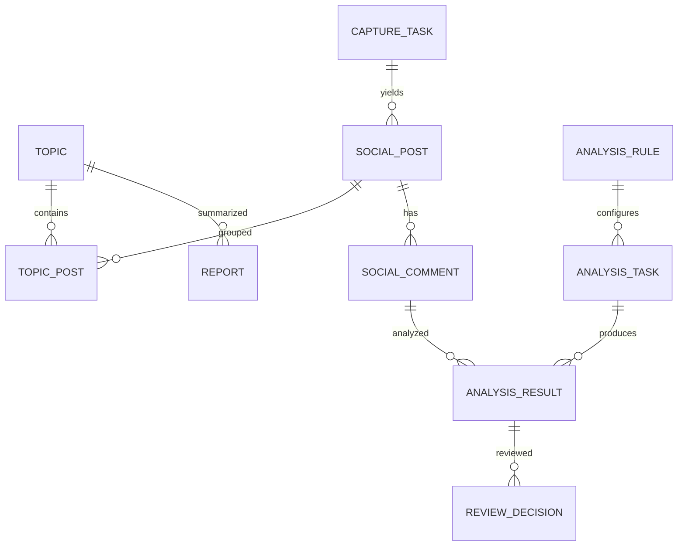

# 业务数据模型 — SystemOne V1

本文件定义 V1 目标实体、字段约束、关系与派生口径。TypeScript 初步定义位于 `src/types/entities.ts`，后续功能需同步精化 schema 与验证。

## 1. 核心关系

实际实现可使用多对多关联表 `TopicPost`、`TopicComment`，导入数据可增加 `CaptureTaskItem`。当前简化 TS 类型 `SocialPost.topicIds` 是易于演示的表达，正式实现前以关系为准。

## 2. 实体定义

| 实体 | 关键字段 | 核心约束 |
| --- | --- | --- |
| Topic | id, title, summary, keywords[], createdAt, updatedAt | 标题非空、keywords 去重 |
| SocialPost | id, platform, sourceId, url, text, publishedAt, topicIds[] | `(platform,sourceId)` 唯一；模拟 URL 不链接真实隐私对象 |
| SocialComment | id, postId, sourceId, parentCommentId?, text, publishedAt, collectedAt | `postId` 必须存在；`parentCommentId` 若有须同帖 |
| CaptureTask | id, mode(url/keyword/import), input, status, total, processed, createdAt, updatedAt, error? | `0 ≤ processed ≤ total`；失败包含错误 |
| AnalysisRule | id, name, version, dimensions[], promptTemplate, outputSchemaVersion | `(id,version)` 可回溯，已执行任务的版本不可原位覆盖 |
| AnalysisTask | id, ruleId, ruleVersion, commentIds[], status, total, processed, createdAt | 注入关联快照；不可引用不存在的评论 |
| AnalysisResult | id, commentId, analysisTaskId, ruleId, ruleVersion, relevance, ironyProbability, sentiment, reviewPriority, tags[], evidence[], explanation, confidence, createdAt | 评分整数 0..100；confidence 0..1；证据需来源文本可追溯 |
| ReviewDecision | id, resultId, status, note?, reviewedAt | 追加写入；当前态由最新记录确定，不删除历史 |
| Report | id, topicId, title, status, contentMarkdown, generatedAt, updatedAt | 绑定快照版本及来源集合，导出使用最新已保存正文 |

状态枚举：

- TaskStatus: `pending | running | completed | failed | canceled`
- ReviewStatus: `pending | confirmed | uncertain | rejected`
- ReportStatus: `draft | ready | exported`
- Sentiment: `positive | neutral | negative | mixed | unclear`

建议额外规范字段（业务实装时加入）：`sourceProvenance`（公开来源类型、采集时间、模拟标识）、`schemaVersion`、`snapshotId`、`createdBy='demo-user'`、`analysisEngine='mock'`、`reviewHistory`、`exportedAt`。不要在演示数据中存储真实用户邮箱、电话号码或敏感身份属性。

## 3. 分数语义与展示

- **relevance**：与用户所选专题或规则的内容相关程度；0–100，**不是政治立场**。
- **ironyProbability**：表达可能包含反讽手法的指示性数值；没有上下文时降低置信度。
- **reviewPriority**：根据主题相关性、歧义程度、任务目标排序人工复核工作；不得等同为“言论风险”或个人风险分。
- **confidence**：模型对所输出解释的自评/校准程度，0..1；模拟阶段不声称统计校准效果。
- **evidence[]**：原文片段、相应帖子上下文或可核查出处；无法获得时给出“缺少上下文”。

## 4. 聚合指标口径

- 采集评论量：当前周期内首次入库的 `SocialComment` 唯一数量。
- 已研判评论量：有至少一条完成结果的唯一 commentId 数；重复任务不重复统计。
- 待复核量：存在有效分析结果且未有最终 `confirmed/rejected` 决策的评论（`uncertain` 是否继续待办需在实现前固定；默认算待复核）。
- 活跃采集任务：`status in (pending,running)` 的任务数。
- 专题热度：按专题关联评论在日粒度聚合，发布日期与采集日期要注明口径。
- 报告引用：报告快照引用专题 ID、分析任务与结果 ID 集合，不因后续数据变更而默默改写已导出版本。

## 5. 不变量与删除策略

- 帖子删除前检查评论与专题引用；默认拒绝级联删除并提示 409。
- 研判结果必须关联存在的规则版本和分析任务；已复核结果不能被覆盖。
- 任务进度只前进，取消/失败为终态；允许手动创建新重试任务并保留原任务审计。
- 所有前端列表采用实体 ID 作为 React `rowKey`，禁止数组下标。
